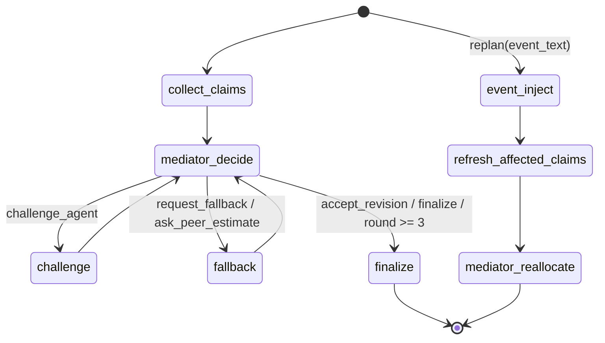

# System Design

## Purpose and agents

The Disaster Relief Resource Negotiator allocates scarce response resources
under changing flood conditions. It has **five agents** with distinct roles:
Medical, Shelter, Logistics, Mediator, and Scenario. Medical, Shelter, and
Logistics submit competing `Claim`s. Mediator challenges claims, requests
fallbacks or estimates, and produces an inventory-safe `Plan`. Scenario turns
an event into a validated patch, identifies affected agents, and enables
replanning.

The design uses an **orchestrator-worker** pattern. LangGraph owns the bounded
negotiation state and routes mediator actions. Workers gather domain evidence
and advocate for their assigned needs; the Mediator weighs claims and makes a
deterministic final allocation. A single general-purpose agent would hide
trade-offs between urgent patient transport, mass evacuation, and supply
delivery inside one response. Separate claims make those competing needs,
concessions, and unresolved shortfalls visible and auditable.

## Architecture and data flow

```mermaid
flowchart TD
<<<<<<< HEAD
  UI[Streamlit control room] -->|Scenario / event text| RUN[ui.runner]
  RUN -->|Scenario, LLM, Tracer| GRAPH[LangGraph orchestrator]
  GRAPH -->|NegotiationState| MED[Medical agent]
  GRAPH -->|NegotiationState| SHEL[ Shelter agent]
  GRAPH -->|NegotiationState| LOG[Logistics agent]
  GRAPH -->|Event text| SCEN[Scenario agent]
  MED -->|Claim / Estimate| GRAPH
  SHEL -->|Claim / Estimate| GRAPH
  LOG -->|Claim / Estimate| GRAPH
  SCEN -->|Patched state + affected_agents| GRAPH
  GRAPH -->|Claims, counters, estimates| M[ Mediator agent]
  M -->|Counter / decision| GRAPH
  M -->|Plan allocation| GRAPH
  GRAPH -->|Plan + trace events| RUN
  RUN -->|Transcript, allocation, warnings| UI

  MED -->|hospital_capacity, casualty_estimate| TOOLS[lib.toolcall / tools.registry]
  SHEL -->|shelter_capacity, zone_population| TOOLS
  LOG -->|road_status, vehicle_inventory, stock_levels| TOOLS
  TOOLS -->|ToolResult / failure details| MED
  TOOLS -->|ToolResult / failure details| SHEL
  TOOLS -->|ToolResult / failure details| LOG
  TOOLS -->|tool_requested / tool_result| TRACE[Tracer / JSONL]
  MED -->|claims / estimates| TRACE
  SHEL -->|claims / estimates| TRACE
  LOG -->|claims / estimates| TRACE
  SCEN -->|event / rejection| TRACE
  M -->|decisions / plan| TRACE
  GRAPH -->|state transitions| TRACE
  LLM[LLMClient or StubLLM] <-->|Structured JSON| MED
  LLM <-->|Structured JSON| SHEL
  LLM <-->|Structured JSON| LOG
  LLM <-->|Decisions / reasoning| M
  LLM <-->|ScenarioPatch| SCEN
=======
  UI[Streamlit control room] --> R[ui.runner boundary<br/>placeholder]
  R --> N[graph.negotiation<br/>orchestrator]
  N --> S[Scenario agent<br/>event injector & diff validator]
  N --> M[Medical agent<br/>critical care]
  N --> H[Shelter agent<br/>evacuation & displaced]
  N --> L[Logistics agent<br/>routes & resources]
  M --> X[Mediator agent<br/>decision & early finalization]
  H --> X
  L --> X
  S --> N
  N --> RP[graph.replan<br/>affected-agent derivation]
  RP --> N
  X --> N
  N --> T[Tracer]
  N --> O[Plan output]
>>>>>>> dev-b
```

Each need agent calls tools through `lib.toolcall.call_tool`. That boundary
looks up the function in `tools.registry.TOOLS`, records the request and
result, catches `ToolError`, and returns `ToolResult`. The seven registered
tools are `hospital_capacity`, `casualty_estimate`, `shelter_capacity`,
`zone_population`, `road_status`, `vehicle_inventory`, and `stock_levels`.
`tools.failure` can inject targeted, wildcard, random, or timeout failures.
Agents record unavailable telemetry, set claim uncertainty, and retain a
baseline fallback estimate.

## Orchestration and replanning

`graph.negotiation.run_negotiation(scenario, llm, tracer)` collects claims from
Medical, Shelter, and Logistics, asks Mediator for the next
`MediatorAction`, and routes `challenge_agent` to a revision or
`request_fallback` / `ask_peer_estimate` to an estimate. The graph finalizes
when Mediator selects `finalize` or the three-round cap is reached.

<<<<<<< HEAD
`graph.replan.replan(state, event_text, llm, tracer)` invokes
`agents.scenario.inject_event`. The Scenario agent patches a deep copy of the
scenario and sets `affected_agents`; replan refreshes only those agents' claims,
keeps all other claims, increments `replans`, and asks Mediator to allocate
again. The UI compares this plan with the first run.
=======
| Agent | Responsibility | Status |
|---|---|---|
| Medical | Prioritize critical patients | Implemented |
| Shelter | Prioritize stranded residents | Implemented |
| Logistics | Model transport constraints | Implemented |
| Mediator | Resolve conflicts, challenge oversubscriptions, and finalize | Implemented |
| Scenario | Inject changing conditions & validate state mutations | Implemented |
>>>>>>> dev-b

Allocation and negotiation use the same `score_claim`: people at risk × urgency
× inverse response window × a per-claim road-access factor. Explicitly named
zones determine access when present; otherwise Medical and Shelter use their
affected populations, and unknown claims use a population-weighted zone average.
The access factor has a 0.05 floor so a blocked route lowers a score without
erasing it. For an oversubscribed resource, each claimant receives one unit
when inventory can cover that minimum; the remaining units are divided by score
with largest-remainder rounding, request caps, and inventory caps. Equal scores
break ties by urgency, shorter response window, then agent name.

<<<<<<< HEAD
Final allocation reasoning must give each claimant a non-empty explanation with
its score, rank, requested and awarded amounts, shortfall, and comparison with
competing claims. The Mediator retries once if any explanation is missing or
empty, then supplies a deterministic data-based explanation for any remaining
gaps. It records each reduced claim once in `disputes_log`.
=======
Inputs are `Scenario` and optional scenario events. Workers emit `Claim` or
`Estimate`; the mediator emits `MediatorAction` and `Plan`. `NegotiationState`
holds the complete loop state, including `estimates` and `claims`. `ScenarioDiff` models before/after field mutations.

## Negotiation Orchestration & Claim Revisions (`graph/negotiation.py`)

The negotiation loop coordinates dynamic multi-agent compromise:
- **Estimate Feedback**: Estimates gathered via `request_fallback` or `ask_peer_estimate` are stored in `NegotiationState.estimates` and injected into subsequent Mediator context and need agents' revision prompts.
- **Oversubscription & Challenges**: When resources are oversubscribed, the Mediator prefers `challenge_agent` targeting the lowest-scoring or highest-demand claimant. The challenged agent re-evaluates its claim with the Counter and feedback.
- **Claim Revision Tracing**: Revised claims are traced as `claim_revision` events detailing changes in resources, urgency, and time windows. If an agent defends its claim unchanged, its defense justification is recorded.
- **Early Finalization**: The Mediator finalizes as soon as nothing is oversubscribed or claims stop changing, rather than needlessly consuming rounds. The 3-round cap acts solely as a safety net.

## Scenario Event Injection & Diff Validation

The Scenario agent converts environmental events into structured `ScenarioPatch` mutations:
- **Context Resolution**: Events are evaluated against the current scenario context (zones, roads, hospitals, resources). Vague events naming no zone apply across all plausible zones.
- **Concrete Deltas**: Physical events must yield concrete numeric deltas (e.g. `road_access: {"Zone A": 0.0}`). Empty patches are strictly prohibited for valid physical events.
- **Diff & Retry**: Patches are applied to a deep copy of the scenario and diffed against the original. If the diff is empty (a no-op), the agent retries once with an instruction to be specific. If still unchanged, the event is rejected with `is_valid=false` and reason `"event had no effect on the scenario"`.
- **Tracing**: Valid mutations emit an `event_applied` trace with the full before/after diff of changed fields.

## Replan & Affected-Agent Derivation (`graph/replan.py`)

Rather than relying purely on LLM guesses, `affected_agents` are derived deterministically from the fields that actually changed:
- `road/route` changes -> `logistics` is affected, plus every agent whose active claim references that zone must re-claim.
- `casualties/hospital` changes -> `medical` is affected.
- `stranded/shelter` changes -> `shelter` is affected.
- `resources` changes -> `logistics` plus any agent whose claim requested that resource (and LLM nominated resource claimants).
>>>>>>> dev-b



<<<<<<< HEAD
## Roles and domain tools

| Agent | Responsibility | Tools | Output |
|---|---|---|---|
| Medical | Critical patients, triage urgency, hospital capacity, medical transport | `hospital_capacity`, `casualty_estimate` | `Claim`; peer `Estimate` |
| Shelter | Stranded residents, shelter capacity, evacuation and phased rescue | `shelter_capacity`, `zone_population` | `Claim`; peer `Estimate` |
| Logistics | Supplies, vehicles, route access, transport feasibility | `road_status`, `vehicle_inventory`, `stock_levels` | `Claim`; peer `Estimate` |
| Mediator | Challenge claims, request fallback/peer evidence, resolve conflict and allocate inventory | Deterministic scoring and inventory | `MediatorAction`, `Counter`, `Plan` |
| Scenario | Validate event text, patch scenario facts, identify affected domains | LLM-validated `ScenarioPatch` | Updated `NegotiationState` |

## Contracts and samples

The Pydantic models in `lib/schemas.py` are the shared I/O contracts:
`Zone`, `Scenario`, `Claim`, `Counter`, `Estimate`, `MediatorAction`, `Plan`,
and `NegotiationState`. The Scenario agent additionally validates a
`ScenarioPatch`. A compact sample matching those schemas follows.

```json
{
  "scenario": {
    "disaster_type": "flood",
    "zones": [
      {"name": "Zone A", "population": 500, "stranded": 300, "critical_patients": 0, "road_access": 0.5},
      {"name": "Zone B", "population": 120, "stranded": 12, "critical_patients": 12, "road_access": 0.3}
    ],
    "resources": {"boats": 3},
    "hospitals": ["Regional Hospital"],
    "roads": {"Zone A": "blocked", "Zone B": "flooded"}
  },
  "claim": {
    "agent": "medical", "resources": {"boats": 2}, "people_affected": 12,
    "urgency": 10, "time_window_hrs": 2, "justification": "Twelve critical patients need transfer.",
    "fallback_option": "Move the highest acuity patients first.", "uncertainty": 0.0
  },
  "counter": {"to_agent": "medical", "question": "Can you reduce or phase the boat request?"},
  "estimate": {"agent": "logistics", "question": "Is Zone B reachable by truck?", "value": 0.2, "confidence": 0.8, "rationale": "Road access is severely reduced."},
  "mediator_action": "challenge_agent",
  "scenario_patch": {
    "is_valid": true, "summary": "Bridge collapse severs Zone A road access.",
    "affected_agents": ["logistics", "shelter"], "road_access": {"Zone A": 0.0},
    "roads": {"Zone A": "blocked"}, "zone_casualties": {}, "zone_stranded": {},
    "resource_loss": {}, "hospital_capacity": {}, "urgency_hints": {"shelter": 9}
  },
  "plan": {
    "allocation": {"medical": {"boats": 2}, "shelter": {"boats": 1}},
    "justifications": {"medical": "Critical patient urgency", "shelter": "Remaining boat capacity"},
    "conflicts_resolved": ["Demand exceeded boat inventory; awards capped to stock."],
    "replans": 0, "rounds_used": 2, "disputes_log": []
  }
}
```

`NegotiationState` holds the scenario, current round, claims, counters, events,
optional plan, replan count, and affected-agent list. Agent functions accept
that state with an `LLMClient` or `StubLLM` and a `Tracer`. `Tracer.log` keeps
in-memory events and writes each event as JSONL.

## Stack rationale

| Component | Reason |
|---|---|
| Python 3.14.7 | Project runtime; standard typing, JSON, and filesystem APIs |
| Pydantic | Validate scenario, claims, estimates, patches, and plans at agent boundaries |
| LangGraph | Explicit state graph, conditional edges, bounded loop, and replan flow |
| OpenAI-compatible JSON client | Typed model output via OpenAI or Groq with retry and JSON repair; same interface for `StubLLM` |
| Deterministic Python scoring | Reproducible priorities and inventory caps independent of LLM prose |
| Streamlit | Scenario editing, event injection, transcript, allocation comparison, and downloads |
| python-dotenv | Load ignored local `.env` settings without overriding process environment values |
| JSONL Tracer | Auditable, append-only run record suitable for replay and review |

## Runtime and deployment

The dependency pins in `requirements.txt` are the versions installed in the
Python 3.14.7 development environment. Streamlit's current documentation lists
Python 3.14 as supported by Community Cloud and allows version selection in
Advanced settings; Cloud's deployment guide currently says its default is
Python 3.12. Select 3.14 for this app. See [Cloud deployment](https://docs.streamlit.io/deploy/streamlit-community-cloud/deploy-your-app)
and [supported Python versions](https://docs.streamlit.io/knowledge-base/using-streamlit/sanity-checks).
=======
`app.py` provides a Streamlit control room with a JSON scenario loader/editor
validated by the `Scenario` Pydantic model, a Run action, transcript rendering
from `Tracer` events, allocation and justification rows, event injection
presets plus free text, failure injection, and JSONL trace download. Preset buttons
name specific zones and magnitudes (e.g., "Bridge to Zone A collapses, cutting all ground road access to Zone A.").
A UI warning is displayed whenever an event has no effect or is rejected. `ui/runner.py`
is the narrow replacement point for the graph.
>>>>>>> dev-b
