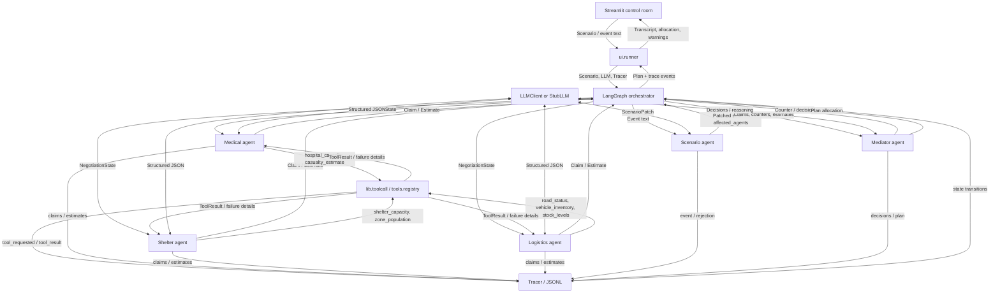
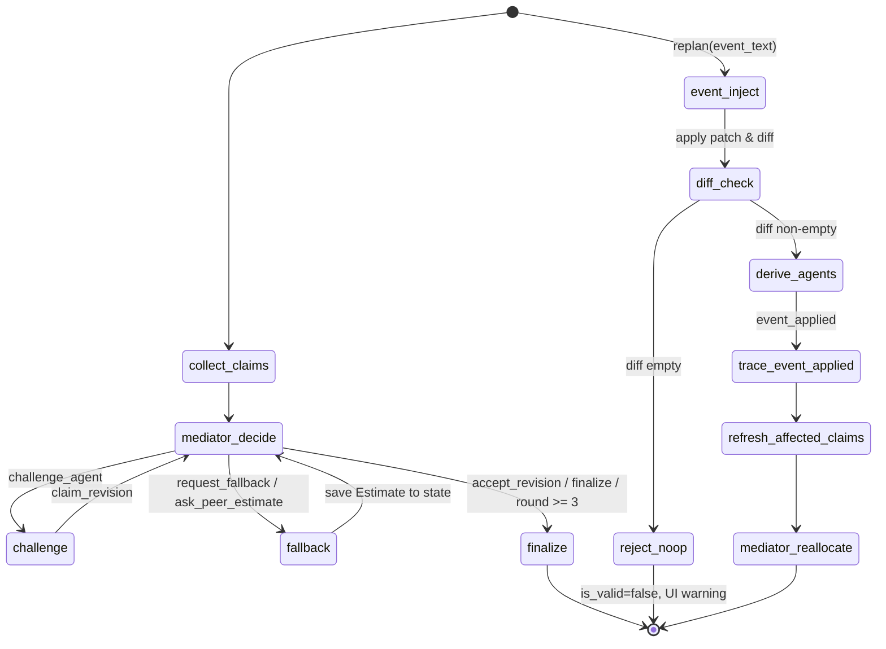

# System Design

## Purpose and agents

The Disaster Relief Resource Negotiator allocates scarce response resources
under changing flood conditions. It has **five agents** with distinct roles:
Medical, Shelter, Logistics, Mediator, and Scenario. Medical, Shelter, and
Logistics submit competing `Claim`s. Mediator challenges claims, requests
fallbacks or estimates, and produces an inventory-safe `Plan`. Scenario turns
an event into a validated patch, identifies affected agents, and enables
replanning.

The design uses an **orchestrator-worker** pattern. LangGraph owns the bounded
negotiation state and routes mediator actions. Workers gather domain evidence
and advocate for their assigned needs; the Mediator weighs claims and makes a
deterministic final allocation. A single general-purpose agent would hide
trade-offs between urgent patient transport, mass evacuation, and supply
delivery inside one response. Separate claims make those competing needs,
concessions, and unresolved shortfalls visible and auditable.

## Architecture and data flow



Each need agent calls tools through `lib.toolcall.call_tool`. That boundary
looks up the function in `tools.registry.TOOLS`, records the request and
result, catches `ToolError`, and returns `ToolResult`. The seven registered
tools are `hospital_capacity`, `casualty_estimate`, `shelter_capacity`,
`zone_population`, `road_status`, `vehicle_inventory`, and `stock_levels`.
`tools.failure` can inject targeted, wildcard, random, or timeout failures.
Agents record unavailable telemetry, set claim uncertainty, and retain a
baseline fallback estimate.

## Orchestration and replanning

`graph.negotiation.run_negotiation(scenario, llm, tracer)` collects claims from
Medical, Shelter, and Logistics, asks Mediator for the next
`MediatorAction`, and routes `challenge_agent` to a revision or
`request_fallback` / `ask_peer_estimate` to an estimate. The graph finalizes
when Mediator selects `finalize` or `accept_revision`, or when the three-round
cap is reached.

**Estimate feedback loop.** Estimates returned by agents during
`request_fallback` / `ask_peer_estimate` are stored in
`NegotiationState.estimates` (not just logged). They are included in the next
Mediator context and available to the target agent's revision prompt. An
estimate informs the next decision or challenge rather than ending at the trace.

**Decision logic.** The Mediator's `decide_next` follows this priority:
1. If a resource is oversubscribed and no agent has revised since the last
   counter, prefer `challenge_agent` so the targeted agent re-claims with the
   Counter.
2. Use `request_fallback` / `ask_peer_estimate` only for uncertain claims or
   failed tools.
3. Choose `finalize` early when nothing is oversubscribed or claims have stopped
   changing. `accept_revision` also routes to finalization so the Mediator can
   allocate from revised evidence. The hard cap at round 3 is a safety net only;
   the graph forces finalization if it is reached.

**Claim revision trace.** After a challenge, the graph traces the revised claim
as event type `claim_revision` with a change summary (resources, urgency,
time_window_hrs vs. the previous claim). An agent may defend its claim unchanged,
but the trace records `defended_unchanged: true` with the justification.

`graph.replan.replan(state, event_text, llm, tracer)` invokes
`agents.scenario.inject_event`. The Scenario agent resolves the event against
the **current** scenario (zones, roads, hospitals, resources passed in context)
and must output concrete numeric deltas. If the event names no specific zone,
the agent applies it to every zone it plausibly affects and explains this in the
summary.

**Patch validation, diff, and retry.** After receiving a `ScenarioPatch`, the
agent applies the patch to a deep copy of the scenario and computes a
`ScenarioDiff` (`lib/schemas.py`). If the patch has empty mutation fields or the
resulting diff is empty (nothing actually changed), the agent retries the event
generation once with an explicit instruction to produce concrete, effective
changes. If the second attempt still produces no actual change, the event is
rejected with `is_valid=false` and the reason `"event had no effect on the
scenario"`. A UI warning is shown, and no-ops are never reported as successful
replans.

**Derived affected agents.** `affected_agents` is derived from the fields that
actually changed in the diff, not solely from the LLM's guess:
- `road_access` or `roads` change → `logistics`, `medical`, `shelter`
- `critical_patients` or `hospital_capacity` change → `medical`
- `stranded` change → `shelter`
- `resources` change → all agents

When road access changes for a zone, every agent whose existing claim references
that zone is also added so they re-claim with updated conditions.

**Trace.** A successful patch logs an `event_applied` trace event containing the
patch, the `ScenarioDiff`, and the derived `affected_agents`. Rejected no-op
events instead produce `event_rejected` and do not advance replanning.

Replan refreshes only affected agents' claims, keeps all other claims,
increments `replans`, and asks Mediator to allocate again. If the event was
rejected (no affected agents), replan returns the unmodified state without
incrementing `replans`. The UI compares this plan with the first run.

Allocation and Mediator context use the same `score_claim` formula:
`Claim.people_affected × urgency × (1 / max(time_window_hrs, 1)) × road_access_factor`.
Road access is computed for each claim from the zones it names. If no zone is
named, Medical uses critical-patient zones and Shelter uses stranded-population
zones, weighted by the relevant people count; otherwise access is weighted by
zone population. The road-access factor is floored at `0.05`, so a blocked
route lowers a score without erasing it. For an oversubscribed resource, the
Mediator splits inventory proportionally by score with largest-remainder
rounding, caps each award at that claim's request, and caps total awards at
inventory. When inventory can cover one unit for every claimant, each gets
that one-unit foothold before the remaining units are split proportionally.
Ties break by score descending, urgency descending, shorter response window,
then agent name.

Final allocation reasoning must give each claimant a non-empty explanation with
its score, rank, requested and awarded amounts, shortfall, and comparison with
competing claims. The Mediator retries once if any explanation is missing or
empty, then supplies a deterministic data-based explanation for any remaining
gaps. It records each reduced claim once in `disputes_log`.



## Roles and domain tools

| Agent | Responsibility | Tools | Output |
|---|---|---|---|
| Medical | Critical patients, triage urgency, hospital capacity, medical transport | `hospital_capacity`, `casualty_estimate` | `Claim`; peer `Estimate` |
| Shelter | Stranded residents, shelter capacity, evacuation and phased rescue | `shelter_capacity`, `zone_population` | `Claim`; peer `Estimate` |
| Logistics | Supplies, vehicles, route access, transport feasibility | `road_status`, `vehicle_inventory`, `stock_levels` | `Claim`; peer `Estimate` |
| Mediator | Challenge claims, request fallback/peer evidence, resolve conflict and allocate inventory | Deterministic scoring and inventory | `MediatorAction`, `Counter`, `Plan` |
| Scenario | Validate event text, patch scenario facts, diff before/after, derive affected agents | LLM-validated `ScenarioPatch`, `ScenarioDiff` | Updated `NegotiationState` |

## Contracts and samples

The Pydantic models in `lib/schemas.py` are the shared I/O contracts:
`Zone`, `Scenario`, `Claim`, `Counter`, `Estimate`, `MediatorAction`, `Plan`,
`ScenarioDiff`, and `NegotiationState`. The Scenario agent additionally
validates a `ScenarioPatch` and computes a `ScenarioDiff` to detect no-ops
and derive `affected_agents`. A compact sample matching those schemas follows.

```json
{
  "scenario": {
    "disaster_type": "flood",
    "zones": [
      {"name": "Zone A", "population": 500, "stranded": 300, "critical_patients": 0, "road_access": 0.5},
      {"name": "Zone B", "population": 120, "stranded": 12, "critical_patients": 12, "road_access": 0.3}
    ],
    "resources": {"boats": 3},
    "hospitals": ["Regional Hospital"],
    "roads": {"Zone A": "blocked", "Zone B": "flooded"}
  },
  "claim": {
    "agent": "medical", "resources": {"boats": 2}, "people_affected": 12,
    "urgency": 10, "time_window_hrs": 2, "justification": "Twelve critical patients need transfer.",
    "fallback_option": "Move the highest acuity patients first.", "uncertainty": 0.0
  },
  "counter": {"to_agent": "medical", "question": "Can you reduce or phase the boat request?"},
  "estimate": {"agent": "logistics", "question": "Is Zone B reachable by truck?", "value": 0.2, "confidence": 0.8, "rationale": "Road access is severely reduced."},
  "mediator_action": "challenge_agent",
  "scenario_patch": {
    "is_valid": true, "summary": "Bridge collapse severs Zone A road access.",
    "affected_agents": ["logistics", "shelter"], "road_access": {"Zone A": 0.0},
    "roads": {"Zone A": "blocked"}, "zone_casualties": {}, "zone_stranded": {},
    "resource_loss": {}, "hospital_capacity": {}, "urgency_hints": {"shelter": 9}
  },
  "plan": {
    "allocation": {"medical": {"boats": 2}, "shelter": {"boats": 1}},
    "justifications": {"medical": "Critical patient urgency", "shelter": "Remaining boat capacity"},
    "conflicts_resolved": ["Demand exceeded boat inventory; awards capped to stock."],
    "replans": 0, "rounds_used": 2, "disputes_log": []
  }
}
```

`NegotiationState` holds the scenario, current round, claims, counters,
estimates, events, optional plan, replan count, and affected-agent list.
Estimates collected during `request_fallback` / `ask_peer_estimate` rounds
are stored in `estimates` and fed back into the Mediator context and the
challenged agent's revision prompt. Agent functions accept that state with
an `LLMClient` or `StubLLM` and a `Tracer`. `Tracer.log` keeps in-memory
events and writes each event as JSONL.

## Stack rationale

| Component | Reason |
|---|---|
| Python 3.14.7 | Project runtime; standard typing, JSON, and filesystem APIs |
| Pydantic | Validate scenario, claims, estimates, patches, and plans at agent boundaries |
| LangGraph | Explicit state graph, conditional edges, bounded loop, and replan flow |
| OpenAI-compatible JSON client | Typed model output via OpenAI or Groq with retry and JSON repair; same interface for `StubLLM` |
| Deterministic Python scoring | Reproducible priorities and inventory caps independent of LLM prose |
| Streamlit | Scenario editing, event injection, transcript, allocation comparison, and downloads |
| python-dotenv | Load ignored local `.env` settings without overriding process environment values |
| JSONL Tracer | Auditable, append-only run record suitable for replay and review |

## Runtime and deployment

The dependency pins in `requirements.txt` are the versions installed in the
Python 3.14.7 development environment. Streamlit's current documentation lists
Python 3.14 as supported by Community Cloud and allows version selection in
Advanced settings; Cloud's deployment guide currently says its default is
Python 3.12. Select 3.14 for this app. See [Cloud deployment](https://docs.streamlit.io/deploy/streamlit-community-cloud/deploy-your-app)
and [supported Python versions](https://docs.streamlit.io/knowledge-base/using-streamlit/sanity-checks).
