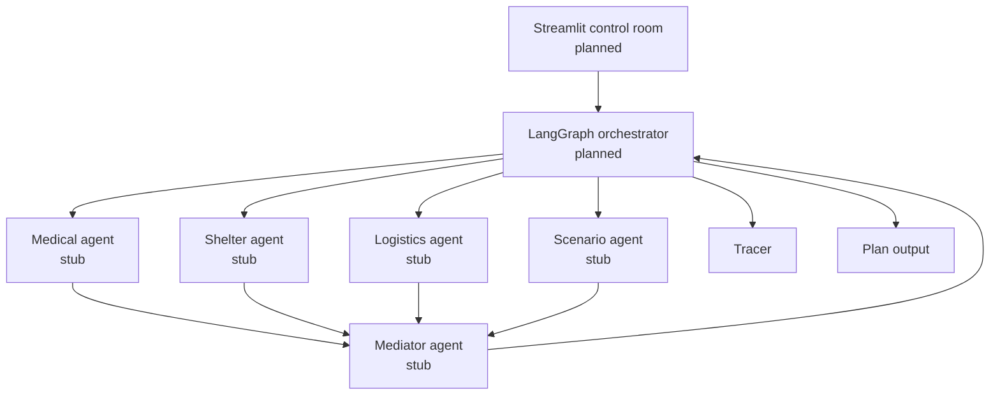

# Design

## Architecture

## Pattern

Orchestrator-worker with bounded negotiation loop.

## Role table

| Agent | Responsibility | Status |
|---|---|---|
| Medical | Prioritize critical patients | Stub |
| Shelter | Prioritize stranded residents | Stub |
| Logistics | Model transport constraints | Stub |
| Mediator | Resolve conflicts and finalize | Stub |
| Scenario | Inject changing conditions | Stub |

## I/O schema

Inputs are `Scenario` and optional scenario events. Workers emit `Claim` or
`Estimate`; the mediator emits `MediatorAction` and `Plan`. `NegotiationState`
holds the complete loop state. LangGraph and Streamlit integration are planned.
