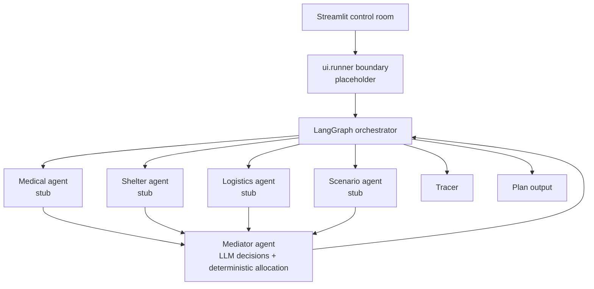
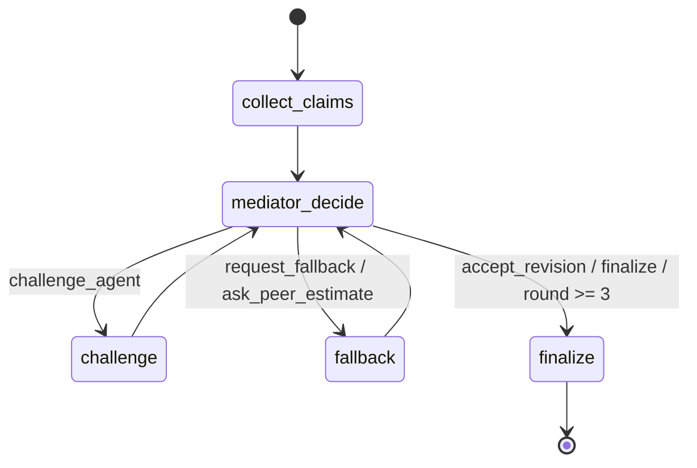

# Design

## Architecture

## Orchestration

`graph.negotiation.run_negotiation(scenario, llm, tracer)` gathers one claim
from each worker, then routes mediator decisions through a bounded negotiation
loop. A challenge sends the mediator's `Counter` to the named worker for a
revised claim. Fallback and peer-estimate actions request evidence from that
worker when the mediator identifies a tool gap or uncertain claim. The loop
ends on a finalize decision or after three rounds; allocation remains the
mediator's deterministic inventory-safe operation.

`graph.replan.replan(state, event_text, llm, tracer)` applies an event through
the Scenario agent, refreshes claims only for the returned `affected_agents`,
then reallocates and increments the replan count. Unaffected claims are kept.

## Role table

| Agent | Responsibility | Status |
|---|---|---|
| Medical | Prioritize critical patients | Stub |
| Shelter | Prioritize stranded residents | Stub |
| Logistics | Model transport constraints | Stub |
| Mediator | Choose state-aware actions and finalize inventory-safe allocation | Implemented |
| Scenario | Inject changing conditions | Stub |

## I/O schema

Inputs are `Scenario` and optional scenario events. Workers emit `Claim` or
`Estimate`; the mediator emits `MediatorAction` and `Plan`. `NegotiationState`
holds the complete loop state.

## Mediator

`decide_next` supplies the LLM with the round, claims, deterministic scores,
inventory over-subscription, missing and uncertain claims, prior counters, and
events. The structured response selects a `MediatorAction`; challenge and
fallback actions also append a targeted `Counter`. Round 3 always forces
finalization. Every decision is traced.

`finalize` ranks claims using deterministic `score_claim` priority per affected
person and caps each award to remaining inventory. The LLM writes reasoning,
resolved conflicts, and dispute notes but cannot change the allocation.
`rounds_used` is copied from the current negotiation state.

## UI

`app.py` provides a Streamlit control room with a JSON scenario loader/editor
validated by the `Scenario` Pydantic model, a Run action, transcript rendering
from `Tracer` events, allocation and justification rows, event injection
presets plus free text, failure injection, and JSONL trace download. `ui/runner.py`
is the narrow replacement point for the graph: its current deterministic
placeholder records scenario and event messages but does not create a plan.
