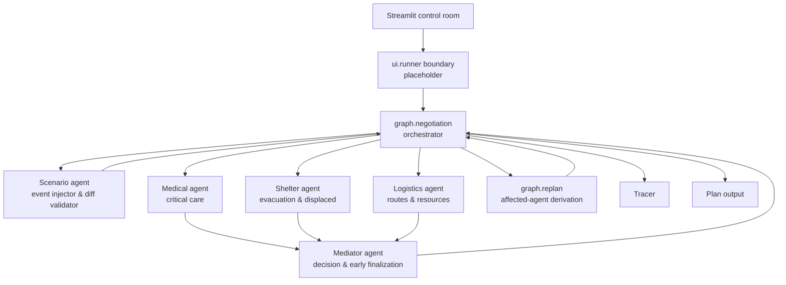

# Design

## Architecture

## Pattern

Orchestrator-worker with bounded negotiation loop.

## Role table

| Agent | Responsibility | Status |
|---|---|---|
| Medical | Prioritize critical patients | Implemented |
| Shelter | Prioritize stranded residents | Implemented |
| Logistics | Model transport constraints | Implemented |
| Mediator | Resolve conflicts, challenge oversubscriptions, and finalize | Implemented |
| Scenario | Inject changing conditions & validate state mutations | Implemented |

## I/O schema

Inputs are `Scenario` and optional scenario events. Workers emit `Claim` or
`Estimate`; the mediator emits `MediatorAction` and `Plan`. `NegotiationState`
holds the complete loop state, including `estimates` and `claims`. `ScenarioDiff` models before/after field mutations.

## Negotiation Orchestration & Claim Revisions (`graph/negotiation.py`)

The negotiation loop coordinates dynamic multi-agent compromise:
- **Estimate Feedback**: Estimates gathered via `request_fallback` or `ask_peer_estimate` are stored in `NegotiationState.estimates` and injected into subsequent Mediator context and need agents' revision prompts.
- **Oversubscription & Challenges**: When resources are oversubscribed, the Mediator prefers `challenge_agent` targeting the lowest-scoring or highest-demand claimant. The challenged agent re-evaluates its claim with the Counter and feedback.
- **Claim Revision Tracing**: Revised claims are traced as `claim_revision` events detailing changes in resources, urgency, and time windows. If an agent defends its claim unchanged, its defense justification is recorded.
- **Early Finalization**: The Mediator finalizes as soon as nothing is oversubscribed or claims stop changing, rather than needlessly consuming rounds. The 3-round cap acts solely as a safety net.

## Scenario Event Injection & Diff Validation

The Scenario agent converts environmental events into structured `ScenarioPatch` mutations:
- **Context Resolution**: Events are evaluated against the current scenario context (zones, roads, hospitals, resources). Vague events naming no zone apply across all plausible zones.
- **Concrete Deltas**: Physical events must yield concrete numeric deltas (e.g. `road_access: {"Zone A": 0.0}`). Empty patches are strictly prohibited for valid physical events.
- **Diff & Retry**: Patches are applied to a deep copy of the scenario and diffed against the original. If the diff is empty (a no-op), the agent retries once with an instruction to be specific. If still unchanged, the event is rejected with `is_valid=false` and reason `"event had no effect on the scenario"`.
- **Tracing**: Valid mutations emit an `event_applied` trace with the full before/after diff of changed fields.

## Replan & Affected-Agent Derivation (`graph/replan.py`)

Rather than relying purely on LLM guesses, `affected_agents` are derived deterministically from the fields that actually changed:
- `road/route` changes -> `logistics` is affected, plus every agent whose active claim references that zone must re-claim.
- `casualties/hospital` changes -> `medical` is affected.
- `stranded/shelter` changes -> `shelter` is affected.
- `resources` changes -> `logistics` plus any agent whose claim requested that resource (and LLM nominated resource claimants).

## UI

`app.py` provides a Streamlit control room with a JSON scenario loader/editor
validated by the `Scenario` Pydantic model, a Run action, transcript rendering
from `Tracer` events, allocation and justification rows, event injection
presets plus free text, failure injection, and JSONL trace download. Preset buttons
name specific zones and magnitudes (e.g., "Bridge to Zone A collapses, cutting all ground road access to Zone A.").
A UI warning is displayed whenever an event has no effect or is rejected. `ui/runner.py`
is the narrow replacement point for the graph.
