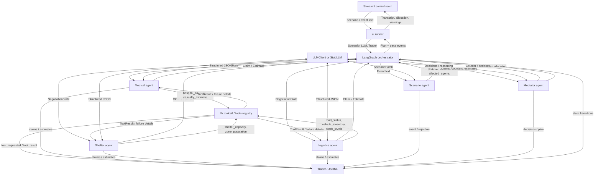
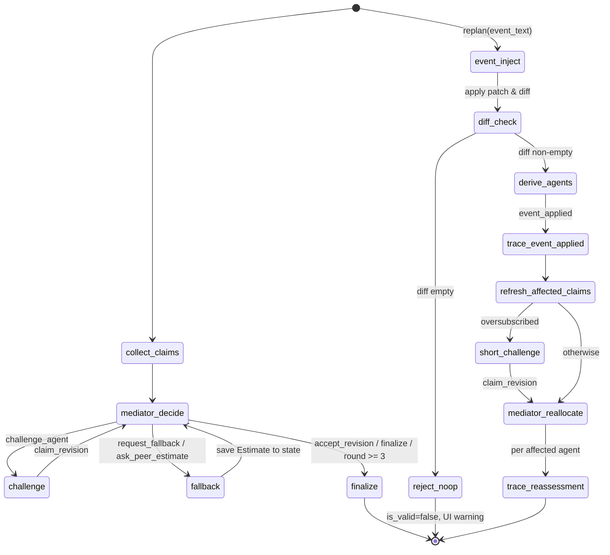

# System Design

## Purpose and agents

The Disaster Relief Resource Negotiator allocates scarce response resources
under changing flood conditions. It has **five agents** with distinct roles:
Medical, Shelter, Logistics, Mediator, and Scenario. Medical, Shelter, and
Logistics submit competing `Claim`s. Mediator challenges claims, requests
fallbacks or estimates, and produces an inventory-safe `Plan`. Scenario turns
an event into a validated patch, identifies affected agents, and enables
replanning.

The design uses an **orchestrator-worker** pattern. LangGraph owns the bounded
negotiation state and routes mediator actions. Workers gather domain evidence
and advocate for their assigned needs; the Mediator weighs claims and makes a
deterministic final allocation. A single general-purpose agent would hide
trade-offs between urgent patient transport, mass evacuation, and supply
delivery inside one response. Separate claims make those competing needs,
concessions, and unresolved shortfalls visible and auditable.

## Architecture and data flow



Each need agent calls tools through `lib.toolcall.call_tool`. That boundary
looks up the function in `tools.registry.TOOLS`, records the request and
result, catches `ToolError`, and returns `ToolResult`. The seven registered
tools are `hospital_capacity`, `casualty_estimate`, `shelter_capacity`,
`zone_population`, `road_status`, `vehicle_inventory`, and `stock_levels`.
`tools.failure` can inject targeted, wildcard, random, or timeout failures.
Agents record unavailable telemetry, set claim uncertainty, and retain a
baseline fallback estimate.

`lib.feasibility` partitions each zone's population into critical patients,
stranded non-critical residents, and other supply-dependent residents. The
groups are mutually exclusive: critical people are removed from the stranded
group, and supply-dependent people are capped to the remaining population.
Claims are clamped to their agent's partition; any requested overlap is
recorded as a `claim_demand_clamped` trace event. The reported total demand is
the union of these groups. Older scenarios without a `supply_dependent` value
use the remaining unclassified population for that group, which is an explicit
model assumption rather than verified field data.

The scenario's `operations` schema carries optional boat capacity, round-trip
hours by zone, ambulance capacity, and hospital facility objects. Missing
capacity and facility values remain `None` and are treated as unverified.
Legacy `hospitals: ["name"]` inputs remain valid and normalize into facility
objects with unknown capacity and transfer status. `boats_needed` uses whole
round trips within the response window; ground fallbacks are infeasible when
`road_access` is zero. `unit_cap` limits known resource awards to the maximum
useful units. These checks report unknowns as unverified, never as confirmed
capacity.

Medical also queries `receiving_capacity` and `transport_options`. Missing ICU
or transfer-acceptance data marks support unverified; known ICU shortfall with
no accepting facility raises a plan risk. Fallbacks naming blocked ground
access or unavailable boats are rejected and traced.

`hospital_capacity` and `receiving_capacity` return facility objects directly
from `Scenario.operations.hospitals`; unknown fields stay `null`. Transport
options mark ground access infeasible below the configured `0.5` demo threshold
or when the named road is blocked or landslide-damaged. `verified` is true only
when every returned capacity and route field relied on by planning is known.
Wayanad's operations values are demonstration assumptions, not verified local
fleet or route measurements. The cited IFRC early-action guidance supports
prioritizing early evacuation and at-risk people but supplies no capacities.

## Orchestration and replanning

`graph.negotiation.run_negotiation(scenario, llm, tracer)` collects claims from
Medical, Shelter, and Logistics, asks Mediator for the next
`MediatorAction`, and routes `challenge_agent` to a revision or
`request_fallback` / `ask_peer_estimate` to an estimate. The graph finalizes
when Mediator selects `finalize` or the three-round safety cap is reached.
One round is a full challenge cycle: every challenged agent must respond
before `round` advances once. It advances once per completed cycle, not once
per counter, and the hard cap remains three rounds.

**Estimate feedback loop.** Estimates returned by agents during
`request_fallback` / `ask_peer_estimate` are stored in
`NegotiationState.estimates` (not just logged). They are included in the next
Mediator context and available to the target agent's revision prompt. An
estimate informs the next decision or challenge rather than ending at the trace.

**Decision logic.** The Mediator's `decide_next` follows this priority:
1. If a resource is oversubscribed, challenge each affected claimant until its
   latest counter receives a changed claim or an unchanged defense with
   evidence. Counter snapshots and rounds are retained; unchanged claims are
   defended, never counted as revisions. Finalize early only after all affected
   claimants respond, or when total requests fit inventory.
2. Use `request_fallback` / `ask_peer_estimate` only for uncertain claims or
   failed tools.
3. The three-round cap is a safety net. At the cap, finalize with
   `status="constrained"` and explicit `unresolved_shortfalls` (resource, unmet
   amount, claimants), rather than implying unresolved demand was settled.

**Claim revision trace.** After a challenge, the graph traces the revised claim
as event type `claim_revision` with a change summary (resources, urgency,
time_window_hrs vs. the previous claim). An agent may defend its claim unchanged,
but the trace records `defended_unchanged: true` with the justification.
After every specialist response, numeric boat-capacity and route-time claims
are checked against `operations`; contradictions are corrected and traced as
`claim_corrected`. Every known resource request is clamped to inventory, while
unknown resource names are dropped from allocation and listed separately as
`Plan.non_inventory_requests`. A revision counts only if it reduces an
oversubscription or adds scenario-specific evidence; urgency and uncertainty
changes alone count as an unchanged defense.

`graph.replan.replan(state, event_text, llm, tracer)` invokes
`agents.scenario.inject_event`. The Scenario agent resolves the event against
the **current** scenario (zones, roads, hospitals, resources passed in context)
and must output concrete numeric deltas. If the event names no specific zone,
the agent applies it to every zone it plausibly affects and explains this in the
summary.

**Patch validation, diff, and retry.** After receiving a `ScenarioPatch`, the
agent applies the patch to a deep copy of the scenario and computes a
`ScenarioDiff` (`lib/schemas.py`). If the patch has empty mutation fields or the
resulting diff is empty (nothing actually changed), the agent retries the event
generation once with an explicit instruction to produce concrete, effective
changes. If the second attempt still produces no actual change, the event is
rejected with `is_valid=false` and the reason `"event had no effect on the
scenario"`. A UI warning is shown, and no-ops are never reported as successful
replans.

Exact demo `PRESET_EVENTS` have deterministic patches so the displayed event
always produces the described diff. `hospital_capacity` updates the named
receiving-facility record (including zero free ICU beds and transfer refusal
for the full-capacity preset), and the actual field diff re-triggers Medical.

**Derived affected agents.** `affected_agents` is derived from the fields that
actually changed in the diff, not solely from the LLM's guess:
- `road_access` or `roads` change → `logistics`, `medical`, `shelter`
- `critical_patients` or `hospital_capacity` change → `medical`
- `stranded` change → `shelter`
- `resources` change → all agents

When road access changes for a zone, every agent whose existing claim references
that zone is also added so they re-claim with updated conditions.

**Trace.** A successful patch logs an `event_applied` trace event containing the
patch, the `ScenarioDiff`, and the derived `affected_agents`. Rejected no-op
events instead produce `event_rejected` and do not advance replanning.

Replan refreshes only affected agents' claims, keeps all other claims,
increments `replans`, and, if those claims remain oversubscribed, asks one
affected claimant to answer a short counter before Mediator reallocates. Each
affected agent receives a `reassessment` trace with before/after scores,
requests, awards, and reason; the UI uses that reason in the allocation table.
If the event was
rejected (no affected agents), replan returns the unmodified state without
incrementing `replans`. The UI compares this plan with the first run.

Allocation and Mediator context use the same `score_claim` formula:
`people_affected × severity_weight × urgency × (1 / max(time_window_hrs, 1)) × road_access_factor × feasibility_multiplier`.
Severity weights are policy assumptions listed in `docs/ASSUMPTIONS.md`.
Road access is computed for each claim from the zones it names. If no zone is
named, Medical uses critical-patient zones and Shelter uses stranded-population
zones, weighted by the relevant people count; otherwise access is weighted by
zone population. The road-access factor is floored at `0.05`, so a blocked
route lowers a score without erasing it. For an oversubscribed resource, the
Mediator allocates score tiers in priority order up to each claim's useful
`unit_cap`; only an equally scored tier shares insufficient stock
proportionally with largest-remainder rounding. Total awards are capped at
inventory. Ties break by score descending, urgency descending, shorter response window,
then agent name.

Life-safety allocation is lexicographic: Medical critical-patient demand first,
Shelter stranded non-critical demand second, then Logistics supply-dependent
demand. Within each tier, scores determine proportional shares. `Plan` reports
both agent totals and `allocation_by_zone`; boats require known feasible round
trips and trucks require a ground-feasible zone. Unusable inventory remains
unassigned. Per-zone `coverage` reports demand, people served, and percentage
using `units × capacity × floor(response_window / round_trip_hours)`. The plan
sets `life_safety_gap` if any critical patients remain uncovered.

Final allocation reasoning must give each claimant a non-empty explanation with
its score, rank, requested and awarded amounts, shortfall, and comparison with
competing claims. The Mediator validates the numeric citations and priority
language, life-safety tier, and critical-patient gap, retries once with listed
contradictions, then uses deterministic data-based explanations if the repair
is still inconsistent or fails. Decision events preserve the LLM's reasoning;
when unavailable, the safety fallback is explicitly traced with
`reasoning_source="fallback"`. `Plan`
also carries `feasibility_report` with checks, unresolved shortfalls, unknown
assumptions, and de-duplicated demand totals. It records each claim once in
`disputes_log`: actual claim changes are
described as revisions; Mediator stock caps say "awarded X of Y requested" and
are never misattributed to the agent.



## Roles and domain tools

| Agent | Responsibility | Tools | Output |
|---|---|---|---|
| Medical | Critical patients, triage urgency, hospital capacity, medical transport | `hospital_capacity`, `receiving_capacity`, `transport_options`, `casualty_estimate` | `Claim`; peer `Estimate` |
| Shelter | Stranded residents, shelter capacity, evacuation and phased rescue | `shelter_capacity`, `zone_population` | `Claim`; peer `Estimate` |
| Logistics | Supplies, vehicles, route access, transport feasibility | `road_status`, `vehicle_inventory`, `stock_levels` | `Claim`; peer `Estimate` |
| Mediator | Challenge claims, request fallback/peer evidence, resolve conflict and allocate inventory | Deterministic scoring and inventory | `MediatorAction`, `Counter`, `Plan` |
| Scenario | Validate event text, patch scenario facts, diff before/after, derive affected agents | LLM-validated `ScenarioPatch`, `ScenarioDiff` | Updated `NegotiationState` |

## Contracts and samples

The Pydantic models in `lib/schemas.py` are the shared I/O contracts:
`Zone`, `Hospital`, `Operations`, `Scenario`, `Claim`, `Counter`, `Estimate`,
`MediatorAction`, `Plan`, `ScenarioDiff`, and `NegotiationState`. The Scenario agent additionally
validates a `ScenarioPatch` and computes a `ScenarioDiff` to detect no-ops
and derive `affected_agents`. Runnable examples are `samples/input.json` and
`samples/output.json`; the latter is an illustrative constrained plan, not a
verified incident allocation. See `docs/ASSUMPTIONS.md` for every demo value.

```json
{
  "scenario": {
    "disaster_type": "flood",
    "zones": [
      {"name": "Zone A", "population": 500, "stranded": 300, "critical_patients": 0, "road_access": 0.5, "supply_dependent": 150},
      {"name": "Zone B", "population": 120, "stranded": 12, "critical_patients": 12, "road_access": 0.3, "supply_dependent": 50}
    ],
    "resources": {"boats": 3},
    "hospitals": ["Regional Hospital"],
    "roads": {"Zone A": "blocked", "Zone B": "flooded"},
    "operations": {
      "boat_capacity_persons": 50,
      "trip_hours_by_zone": {"Zone A": 2.0, "Zone B": 2.0},
      "ambulance_capacity": 2,
      "hospitals": [{"name": "Regional Hospital"}]
    }
  },
  "claim": {
    "agent": "medical", "resources": {"boats": 2}, "people_affected": 12,
    "urgency": 10, "time_window_hrs": 2, "justification": "Twelve critical patients need transfer.",
    "fallback_option": "Move the highest acuity patients first.", "uncertainty": 0.0
  },
  "counter": {"to_agent": "medical", "question": "Can you reduce or phase the boat request?"},
  "estimate": {"agent": "logistics", "question": "Is Zone B reachable by truck?", "value": 0.2, "confidence": 0.8, "rationale": "Road access is severely reduced."},
  "mediator_action": "challenge_agent",
  "scenario_patch": {
    "is_valid": true, "summary": "Bridge collapse severs Zone A road access.",
    "affected_agents": ["logistics", "shelter"], "road_access": {"Zone A": 0.0},
    "roads": {"Zone A": "blocked"}, "zone_casualties": {}, "zone_stranded": {},
    "resource_loss": {}, "hospital_capacity": {}, "urgency_hints": {"shelter": 9}
  },
  "plan": {
    "allocation": {"medical": {"boats": 2}, "shelter": {"boats": 1}},
    "justifications": {"medical": "Critical patient urgency", "shelter": "Remaining boat capacity"},
    "conflicts_resolved": ["Demand exceeded boat inventory; awards capped to stock."],
    "replans": 0, "rounds_used": 2, "disputes_log": []
  }
}
```

`NegotiationState` holds the scenario, current round, claims, counters,
estimates, events, optional plan, replan count, and affected-agent list.
Estimates collected during `request_fallback` / `ask_peer_estimate` rounds
are stored in `estimates` and fed back into the Mediator context and the
challenged agent's revision prompt. Agent functions accept that state with
an `LLMClient` or `StubLLM` and a `Tracer`. `Tracer.log` keeps in-memory
events and writes each event as JSONL.

## Stack rationale

| Component | Reason |
|---|---|
| Python 3.14.7 | Project runtime; standard typing, JSON, and filesystem APIs |
| Pydantic | Validate scenario, claims, estimates, patches, and plans at agent boundaries |
| LangGraph | Explicit state graph, conditional edges, bounded loop, and replan flow |
| OpenAI-compatible JSON client | Typed model output via OpenAI or Groq with retry and JSON repair; same interface for `StubLLM` |
| Deterministic Python scoring | Reproducible priorities and inventory caps independent of LLM prose |
| Streamlit | Scenario editing, event injection, transcript, allocation comparison, and downloads |
| python-dotenv | Load ignored local `.env` settings without overriding process environment values |
| JSONL Tracer | Auditable, append-only run record suitable for replay and review |

## Runtime and deployment

The dependency pins in `requirements.txt` are the versions installed in the
Python 3.14.7 development environment. Streamlit's current documentation lists
Python 3.14 as supported by Community Cloud and allows version selection in
Advanced settings; Cloud's deployment guide currently says its default is
Python 3.12. Select 3.14 for this app. See [Cloud deployment](https://docs.streamlit.io/deploy/streamlit-community-cloud/deploy-your-app)
and [supported Python versions](https://docs.streamlit.io/knowledge-base/using-streamlit/sanity-checks).

## Trace self-check

`scripts/check_trace.py` reads the JSONL, output `Plan`, and matching
`Scenario`. It checks agent participation, challenge/revision, event
reassessment, recovery after tool failure, scenario-supported hospital facts,
inventory totals, numeric justifications, and shortfall resource names. It
prints PASS/FAIL for each invariant and exits nonzero on failure. It does not
repair or rewrite either artifact.

## UI presentation

Pure helpers in `ui/format.py` convert trace events into readable summaries,
group events by negotiation round, and summarize plans without relying on newer
optional plan fields. The same helpers produce explicit arrows and reasons for
before/after allocation comparisons. The Streamlit page gives coordinators a
scenario summary and advanced editor in the sidebar, a welcome state with a
read-only sample option, and four views: Plan, Negotiation, What-if events, and
Raw trace. Run progress and missing-key errors use short, actionable messages.
Plan cards report allocations, coverage, risks, remaining shortfalls, and
unknown assumptions. Older plans without zone coverage or other optional fields
render with clear empty states. The Negotiation tab groups plain-language event
summaries by round, supports agent filtering, and hides routine tool calls by
default. The What-if tab builds zone-specific physical events, keeps custom
text separate, exposes the tool-failure toggle, and displays applied/rejected
event history with affected teams and allocation changes. Recorded sample
runs are clearly labelled and keep event controls disabled. Raw trace is
paginated with individual JSON details collapsed.
