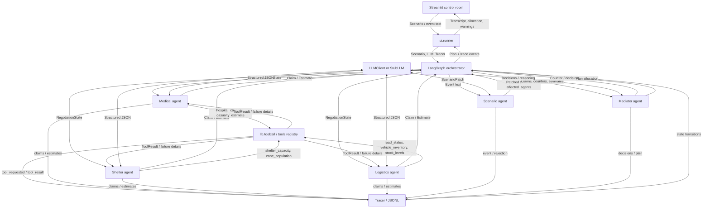
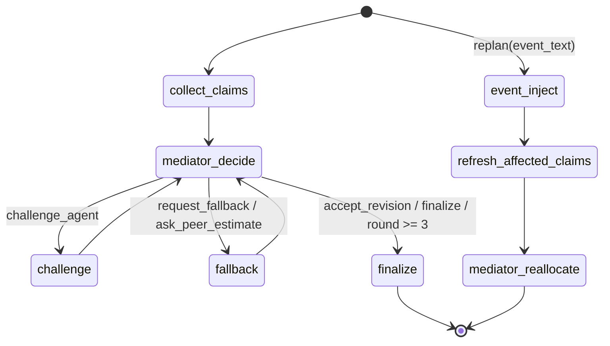

# System Design

## Purpose and agents

The Disaster Relief Resource Negotiator allocates scarce response resources
under changing flood conditions. It has **five agents** with distinct roles:
Medical, Shelter, Logistics, Mediator, and Scenario. Medical, Shelter, and
Logistics submit competing `Claim`s. Mediator challenges claims, requests
fallbacks or estimates, and produces an inventory-safe `Plan`. Scenario turns
an event into a validated patch, identifies affected agents, and enables
replanning.

The design uses an **orchestrator-worker** pattern. LangGraph owns the bounded
negotiation state and routes mediator actions. Workers gather domain evidence
and advocate for their assigned needs; the Mediator weighs claims and makes a
deterministic final allocation. A single general-purpose agent would hide
trade-offs between urgent patient transport, mass evacuation, and supply
delivery inside one response. Separate claims make those competing needs,
concessions, and unresolved shortfalls visible and auditable.

## Architecture and data flow



Each need agent calls tools through `lib.toolcall.call_tool`. That boundary
looks up the function in `tools.registry.TOOLS`, records the request and
result, catches `ToolError`, and returns `ToolResult`. The seven registered
tools are `hospital_capacity`, `casualty_estimate`, `shelter_capacity`,
`zone_population`, `road_status`, `vehicle_inventory`, and `stock_levels`.
`tools.failure` can inject targeted, wildcard, random, or timeout failures.
Agents record unavailable telemetry, set claim uncertainty, and retain a
baseline fallback estimate.

## Orchestration and replanning

`graph.negotiation.run_negotiation(scenario, llm, tracer)` collects claims from
Medical, Shelter, and Logistics, asks Mediator for the next
`MediatorAction`, and routes `challenge_agent` to a revision or
`request_fallback` / `ask_peer_estimate` to an estimate. The graph finalizes
when Mediator selects `finalize` or the three-round cap is reached.

`graph.replan.replan(state, event_text, llm, tracer)` invokes
`agents.scenario.inject_event`. The Scenario agent patches a deep copy of the
scenario and sets `affected_agents`; replan refreshes only those agents' claims,
keeps all other claims, increments `replans`, and asks Mediator to allocate
again. The UI compares this plan with the first run.



## Roles and domain tools

| Agent | Responsibility | Tools | Output |
|---|---|---|---|
| Medical | Critical patients, triage urgency, hospital capacity, medical transport | `hospital_capacity`, `casualty_estimate` | `Claim`; peer `Estimate` |
| Shelter | Stranded residents, shelter capacity, evacuation and phased rescue | `shelter_capacity`, `zone_population` | `Claim`; peer `Estimate` |
| Logistics | Supplies, vehicles, route access, transport feasibility | `road_status`, `vehicle_inventory`, `stock_levels` | `Claim`; peer `Estimate` |
| Mediator | Challenge claims, request fallback/peer evidence, resolve conflict and allocate inventory | Deterministic scoring and inventory | `MediatorAction`, `Counter`, `Plan` |
| Scenario | Validate event text, patch scenario facts, identify affected domains | LLM-validated `ScenarioPatch` | Updated `NegotiationState` |

## Contracts and samples

The Pydantic models in `lib/schemas.py` are the shared I/O contracts:
`Zone`, `Scenario`, `Claim`, `Counter`, `Estimate`, `MediatorAction`, `Plan`,
and `NegotiationState`. The Scenario agent additionally validates a
`ScenarioPatch`. A compact sample matching those schemas follows.

```json
{
  "scenario": {
    "disaster_type": "flood",
    "zones": [
      {"name": "Zone A", "population": 500, "stranded": 300, "critical_patients": 0, "road_access": 0.5},
      {"name": "Zone B", "population": 120, "stranded": 12, "critical_patients": 12, "road_access": 0.3}
    ],
    "resources": {"boats": 3},
    "hospitals": ["Regional Hospital"],
    "roads": {"Zone A": "blocked", "Zone B": "flooded"}
  },
  "claim": {
    "agent": "medical", "resources": {"boats": 2}, "people_affected": 12,
    "urgency": 10, "time_window_hrs": 2, "justification": "Twelve critical patients need transfer.",
    "fallback_option": "Move the highest acuity patients first.", "uncertainty": 0.0
  },
  "counter": {"to_agent": "medical", "question": "Can you reduce or phase the boat request?"},
  "estimate": {"agent": "logistics", "question": "Is Zone B reachable by truck?", "value": 0.2, "confidence": 0.8, "rationale": "Road access is severely reduced."},
  "mediator_action": "challenge_agent",
  "scenario_patch": {
    "is_valid": true, "summary": "Bridge collapse severs Zone A road access.",
    "affected_agents": ["logistics", "shelter"], "road_access": {"Zone A": 0.0},
    "roads": {"Zone A": "blocked"}, "zone_casualties": {}, "zone_stranded": {},
    "resource_loss": {}, "hospital_capacity": {}, "urgency_hints": {"shelter": 9}
  },
  "plan": {
    "allocation": {"medical": {"boats": 2}, "shelter": {"boats": 1}},
    "justifications": {"medical": "Critical patient urgency", "shelter": "Remaining boat capacity"},
    "conflicts_resolved": ["Demand exceeded boat inventory; awards capped to stock."],
    "replans": 0, "rounds_used": 2, "disputes_log": []
  }
}
```

`NegotiationState` holds the scenario, current round, claims, counters, events,
optional plan, replan count, and affected-agent list. Agent functions accept
that state with an `LLMClient` or `StubLLM` and a `Tracer`. `Tracer.log` keeps
in-memory events and writes each event as JSONL.

## Stack rationale

| Component | Reason |
|---|---|
| Python 3.14.7 | Project runtime; standard typing, JSON, and filesystem APIs |
| Pydantic | Validate scenario, claims, estimates, patches, and plans at agent boundaries |
| LangGraph | Explicit state graph, conditional edges, bounded loop, and replan flow |
| OpenAI-compatible JSON client | Typed model output via OpenAI or Groq with retry and JSON repair; same interface for `StubLLM` |
| Deterministic Python scoring | Reproducible priorities and inventory caps independent of LLM prose |
| Streamlit | Scenario editing, event injection, transcript, allocation comparison, and downloads |
| python-dotenv | Load ignored local `.env` settings without overriding process environment values |
| JSONL Tracer | Auditable, append-only run record suitable for replay and review |

## Runtime and deployment

The dependency pins in `requirements.txt` are the versions installed in the
Python 3.14.7 development environment. Streamlit's current documentation lists
Python 3.14 as supported by Community Cloud and allows version selection in
Advanced settings; Cloud's deployment guide currently says its default is
Python 3.12. Select 3.14 for this app. See [Cloud deployment](https://docs.streamlit.io/deploy/streamlit-community-cloud/deploy-your-app)
and [supported Python versions](https://docs.streamlit.io/knowledge-base/using-streamlit/sanity-checks).
