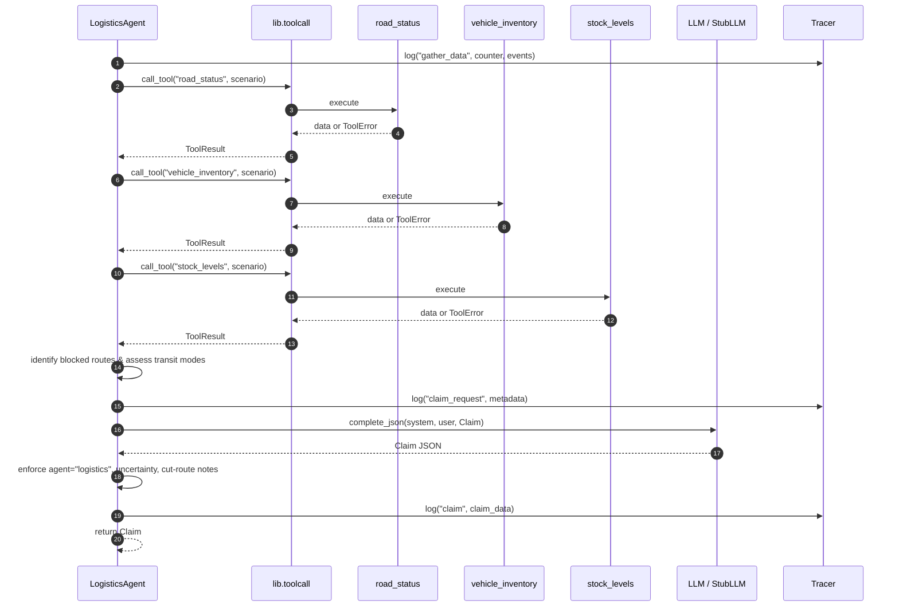

# Logistics Agent (Agent B)

## Role

The Logistics Agent advocates **exclusively** for supply distribution infrastructure,
vehicle allocation (trucks, boats), food rations, clean drinking water, and transport route
feasibility during the multi-agent disaster relief negotiation. It intentionally ignores
clinical triage and temporary shelter bed operations (handled by sibling agents).

It is designed to be **assertive** regarding logistical lifelines, actively **monitoring and
flagging cut routes** (`road_access < 0.5` or flooded/blocked roads) so the Mediator can
adjust priority scores. In addition, it serves as a cross-agent **fallback estimator**,
providing peer route feasibility estimates via `estimate()` when another agent's tools fail.

## Tools Used

| Tool | Purpose |
|---|---|
| `road_status` | Passability, road condition, access scores, and recommended transport modes |
| `vehicle_inventory` | Available trucks, boats, and operational readiness |
| `stock_levels` | Stockpile counts for food rations, water, and emergency commodities |

All three tools are called via `lib.toolcall.call_tool`, ensuring tracing instrumentation
and safe capture of `ToolError`.

## Functions

| Function | Signature | Description |
|---|---|---|
| `make_claim` | `(state, llm, tracer, counter=None) → Claim` | Gathers tool data, identifies cut routes, prompts the LLM, guarantees cut-route flagging in justification, and returns a validated `Claim`. |
| `estimate` | `(state, question, llm, tracer) → Estimate` | Evaluates route feasibility (0.0 to 1.0) or supply availability for peer agents or the Mediator, especially when peer tools fail. |

## Prompt Summary

The system prompt (`agents/prompts/logistics.md`) instructs the LLM to:

1. Advocate only for supply distribution (food, water, fuel), vehicles, and route clearance.
2. Be assertive — assert logistical requirements necessary to support all disaster zones.
3. Cite tool data (`road_status`, `vehicle_inventory`, `stock_levels`).
4. Flag cut/impassable routes (`road_access < 0.5`) in the justification for Mediator visibility.
5. Claim trucks for passable roads and boats for flooded/cut routes.
6. Provide objective route feasibility scores via `estimate()` when requested by peers.
7. On tool failure, set `uncertainty` (0.3–0.8) and describe the telemetry gap.

## Blocked-Road Handling & Mediator Scoring

- **Cut Route Detection**: The agent inspects `road_status` passability flags and `road_access`
  values across all scenario zones. Any zone with `road_access < 0.5` or condition in
  `("blocked", "flooded", "closed")` is classified as cut.
- **Justification Flagging**: The agent ensures the claim justification explicitly lists cut
  corridors so the Mediator can account for route access in priority scoring:
  `score = people_affected * urgency * (1 / time_window) * access`

## Peer Estimates on Route Feasibility

When another agent (e.g. Medical or Shelter) experiences tool failure or needs route verification:
- The peer queries the Logistics Agent via `estimate(state, question, llm, tracer)`.
- The Logistics Agent consults `road_status` and zone road telemetry to calculate an objective
  feasibility score (0.0 to 1.0) with confidence rating and transit rationale.

## Failure Behaviour

When `road_status`, `vehicle_inventory`, or `stock_levels` fails (e.g. via `set_failure()`):

- The tool error is logged in the trace stream and included in prompt context.
- LLM is instructed to set `uncertainty` between 0.3 and 0.8.
- If the LLM omits uncertainty, the code defaults `uncertainty = 0.5`.
- Always returns a valid `Claim` or `Estimate` model.

## Tracing

All actions are logged using `Tracer.log()`:

| Sender | Receiver | Type | Context |
|---|---|---|---|
| `logistics` | `tools` | `gather_data` | Includes counter and active event list |
| `toolcall` | `road_status` | `tool_requested` / `tool_result` | Tool invocation lifecycle |
| `toolcall` | `vehicle_inventory` | `tool_requested` / `tool_result` | Tool invocation lifecycle |
| `toolcall` | `stock_levels` | `tool_requested` / `tool_result` | Tool invocation lifecycle |
| `logistics` | `llm` | `claim_request` | Contains `has_counter`, `tool_failed`, `blocked_routes` |
| `logistics` | `mediator` | `claim` | Final validated claim payload |
| `logistics` | `llm` | `estimate_request` | Target route feasibility question |
| `logistics` | `mediator` | `estimate` | Final validated estimate payload |

## Claim / Counter Flow

