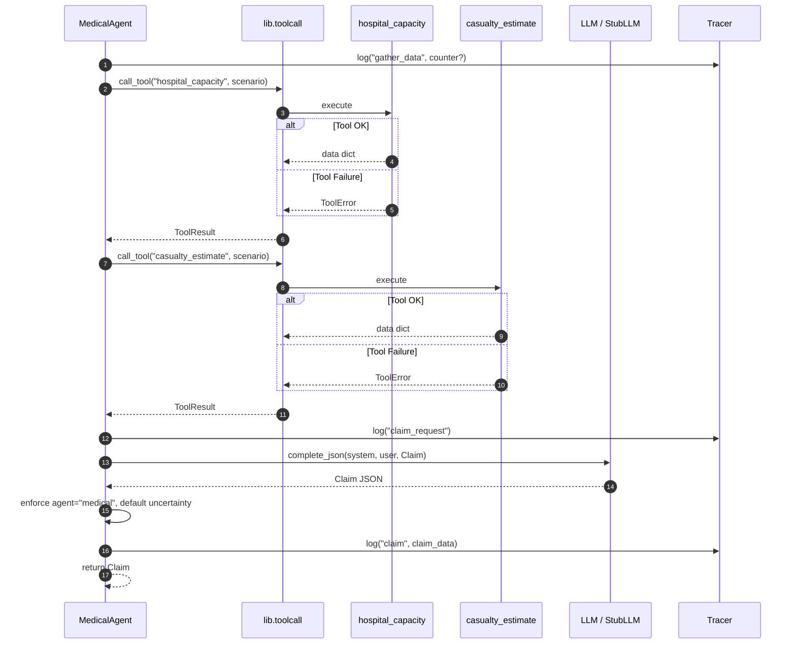

# Medical Agent (Agent B)

## Role

The Medical Agent advocates **exclusively** for medical needs during the
multi-agent disaster relief negotiation. It prioritises critical patients,
hospital capacity, and emergency transport — deliberately ignoring shelter,
logistics, and other non-medical concerns (those belong to sibling agents).

It is designed to be **assertive**: scarce resources mean real conflict with
other agents, which the Mediator resolves.

## Tools Used

| Tool | Purpose |
|---|---|
| `hospital_capacity` | ICU / bed availability, hospital status |
| `casualty_estimate` | Critical patients, triage urgency, injury estimates |

Both are called via `lib.toolcall.call_tool`, which logs every invocation and
catches `ToolError`.

## Functions

| Function | Signature | Description |
|---|---|---|
| `make_claim` | `(state, llm, tracer, counter=None) → Claim` | Gathers tool data, builds an LLM prompt, returns a validated `Claim`. On a `Counter`, defends or revises with evidence. |
| `estimate` | `(state, question, llm, tracer) → Estimate` | Answers a peer / mediator question with a medical estimate backed by tool data. |

## Prompt Summary

The system prompt (`agents/prompts/medical.md`) instructs the LLM to:

1. Advocate only for medical needs.
2. Be assertive — do not reduce requests to avoid conflict.
3. Cite specific tool data (ICU beds, critical patients, urgency).
4. On a Counter, defend with evidence or revise only if warranted.
5. Always include a realistic `fallback_option`.
6. On tool failure, set `uncertainty` (0.3–0.8) and note the data gap.

## Failure Behaviour

When `hospital_capacity` or `casualty_estimate` fails (e.g. via
`set_failure()`), the agent:

- Logs the error in tool data context.
- Instructs the LLM to set `uncertainty` between 0.3 and 0.8.
- If the LLM omits uncertainty despite failure, the code defaults to `0.5`.
- Still returns a **valid** `Claim` — graceful degradation, never a crash.

## Tracing

Every step is logged via `Tracer.log()`:

| Sender | Receiver | Type | When |
|---|---|---|---|
| `medical` | `tools` | `gather_data` | Before tool calls |
| `toolcall` | `hospital_capacity` | `tool_requested` / `tool_result` | During tool calls |
| `toolcall` | `casualty_estimate` | `tool_requested` / `tool_result` | During tool calls |
| `medical` | `llm` | `claim_request` | Before LLM call |
| `medical` | `mediator` | `claim` | After claim generated |
| `medical` | `llm` | `estimate_request` | Before estimate LLM call |
| `medical` | `mediator` | `estimate` | After estimate generated |

## Claim / Counter Flow

