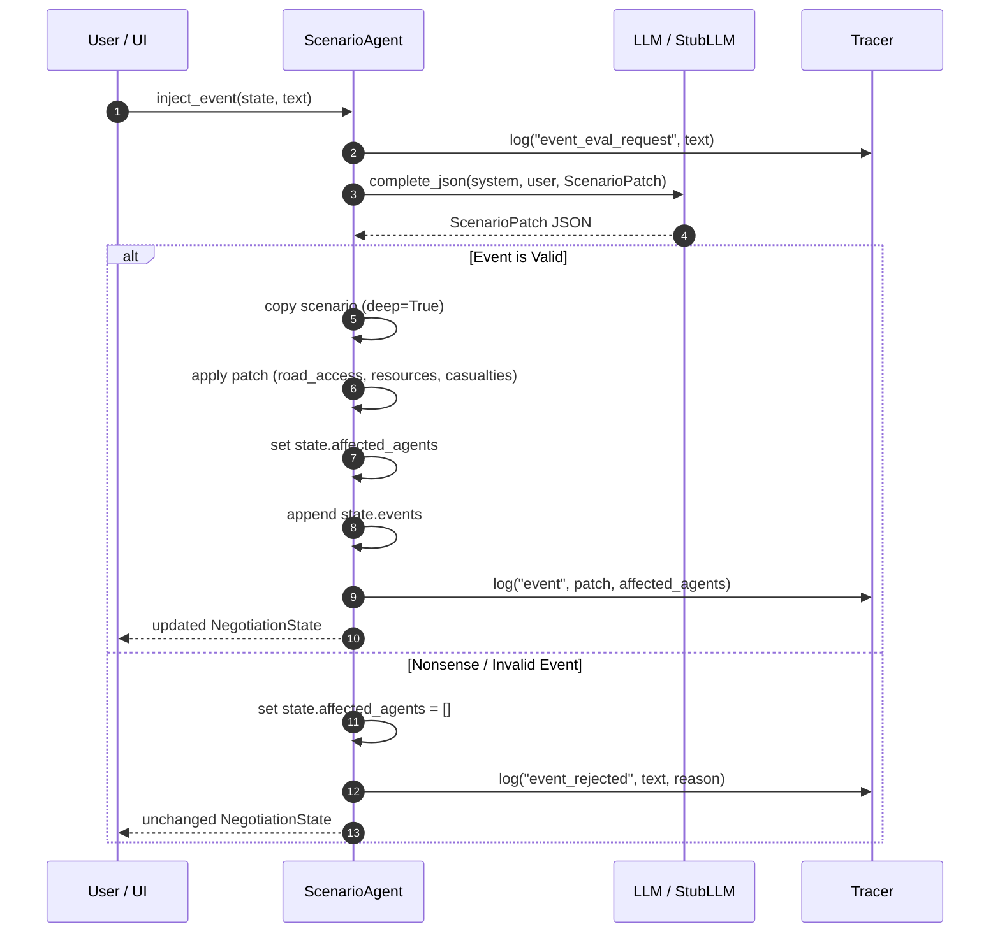

# Scenario Agent (Agent B)

## Role

The Scenario Agent functions as the **environment and simulation controller** in the
disaster relief negotiation. It takes raw text events (from UI preset buttons or user
free-text entries) and translates them via an LLM into structured, validated scenario
patches.

These patches are applied to a **deep copy** of the disaster scenario to dynamically update
road conditions, hospital status, casualty counts, or resource inventories, while signaling
`affected_agents` to trigger re-evaluations or re-planning.

## Functions & Presets

### `inject_event`

```python
inject_event(state: NegotiationState, text: str, llm: Any, tracer: Tracer) -> NegotiationState
```

- Prompts the LLM with the current scenario context and incoming event text.
- Validates plausible events into a `ScenarioPatch`.
- Rejects nonsense or irrelevant events gracefully without mutating the scenario.
- Applies the patch to a **copy** of `state.scenario` (ensuring immutability of the original).
- Sets `state.affected_agents` and records the event in `state.events`.
- Emits structured event traces to `Tracer`.

### `PRESET_EVENTS`

A dictionary of predefined scenario shocks for UI integration:

| Key | Event Description |
|---|---|
| `bridge_collapse` | "Bridge to Zone A collapses, blocking all ground road access." |
| `hospital_capacity` | "Regional Hospital reaches full capacity; ICU beds exhausted." |
| `water_rising_fast` | "Water in Zone A rising faster than forecasted; flooding spreading." |
| `new_casualties` | "Flash surge in Zone B: 15 additional critical casualties reported." |
| `resource_loss` | "Warehouse flood damages supply depot: 1 boat lost and fuel contaminated." |
| `road_blocked` | "Primary access road blocked by landslide." |

## Structured Patch Schema (`ScenarioPatch`)

The LLM returns a strictly typed `ScenarioPatch`:

```json
{
  "is_valid": true,
  "summary": "Bridge collapse severs Zone A road access.",
  "affected_agents": ["logistics", "shelter"],
  "road_access": {"Zone A": 0.0},
  "roads": {"Zone A": "blocked"},
  "zone_casualties": {},
  "zone_stranded": {},
  "resource_loss": {},
  "hospital_capacity": {},
  "urgency_hints": {"shelter": 9, "logistics": 8}
}
```

## Nonsense Rejection

When presented with nonsense, humorous, or irrelevant prompts (e.g., "Aliens landed in Sector 4", "Buy bitcoin", "asdf"):
- The LLM sets `is_valid: false` and provides an explanation in `summary`.
- `inject_event` skips scenario mutation entirely.
- Sets `state.affected_agents = []`.
- Logs `event_rejected` to `Tracer`.
- Returns the clean state without throwing exceptions.

## Tracing

| Sender | Receiver | Type | Context |
|---|---|---|---|
| `scenario` | `llm` | `event_eval_request` | Incoming event text submitted for LLM evaluation |
| `scenario` | `mediator` | `event` | Applied patch, affected agents, and updated scenario |
| `scenario` | `mediator` | `event_rejected` | Event text and reason for rejection |

## Event Injection Flow


