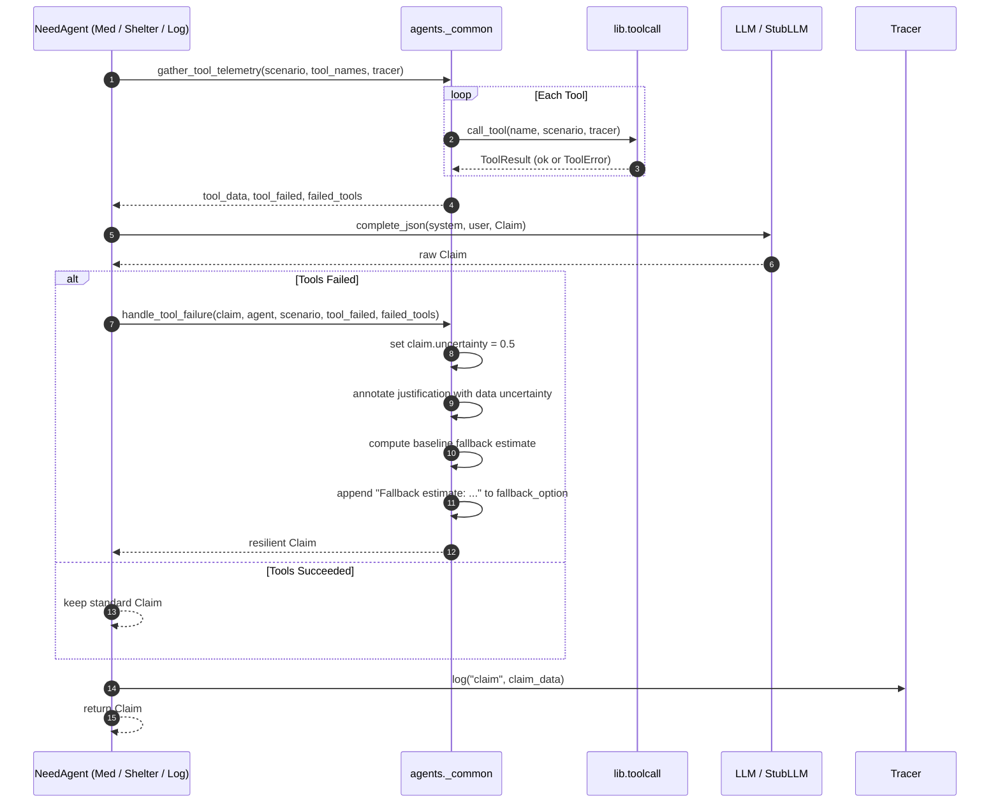

# Scenarios & Failure Handling (Agent B)

## Realistic Monsoon-Flood Scenarios

Two realistic monsoon-flood scenario templates have been authored in `data/scenarios/`, conforming strictly to `lib.schemas.Scenario`:

1. **Cachar District Monsoon Flood (`cachar_monsoon_flood.json`)**:
   - **District**: Cachar District, Assam (Barak River Basin).
   - **Characteristics**: Lowland riverine monsoon flooding with breached embankments, long-duration stagnant floodwaters, and completely severed border plain road access.
   - **Zones**: Silchar Urban, Lakhipur Sub-Division, Sonai River Corridor, Katigorah Border Plain.
   - **Resources**: 12 rescue boats, 8 heavy supply trucks.
   - **Hospitals**: Silchar Medical College Hospital, Lakhipur Civil Hospital.

2. **Wayanad District Monsoon Flood (`wayanad_monsoon_flood.json`)**:
   - **District**: Wayanad District, Kerala (Kabini Basin & Western Ghats).
   - **Characteristics**: High-intensity monsoon deluge combining riverine flash floods and mountain pass landslides/mudflows.
   - **Zones**: Meppadi Valley, Vythiri High Range, Mananthavady Riverine, Sulthan Bathery Lowland.
   - **Resources**: 10 rescue boats, 14 logistics trucks.
   - **Hospitals**: Wayanad District Hospital Mananthavady, Sulthan Bathery Taluk Headquarters Hospital.

Detailed baseline ratios, demographic percentages, road access scales, and resource quota tension designs are documented in [`data/scenarios/ASSUMPTIONS.md`](file:///d:/Academics/SEM%20-%207/Flexi/Disaster_Relief_Resource_Negotiator/data/scenarios/ASSUMPTIONS.md).

---

## Agent Tool Failure Handling

When live scenario data tools fail (injected via `tools/failure.py` or runtime errors), all three need agents (`MedicalAgent`, `ShelterAgent`, `LogisticsAgent`) maintain strict operational resilience without crashing.

### Shared Helper (`agents/_common.py`)

A centralized helper library provides unified tool telemetry and failure recovery across the need agents without altering their public signatures:

- **`gather_tool_telemetry(scenario, tool_names, tracer)`**:
  Executes registered tools through `call_tool`, capturing telemetry dictionaries and isolating failures into `failed_tools`.
- **`get_baseline_fallback_estimate(agent, scenario)`**:
  Derives a deterministic fallback target from scenario baseline metrics:
  - *Medical*: Evaluates cumulative critical patient counts across zones.
  - *Shelter*: Evaluates total stranded residents seeking evacuation shelter.
  - *Logistics*: Evaluates cut-off zones and calculates emergency supply batch requirements.
- **`handle_tool_failure(claim, agent, scenario, tool_failed, failed_tools)`**:
  - Enforces `claim.uncertainty` (defaults to `0.5` if None or 0.0).
  - Explicitly documents the telemetry failure and data uncertainty in `claim.justification`.
  - Appends a concrete, quantified `fallback_estimate` into `claim.fallback_option`.

---

## Tool-Failure Workflow

