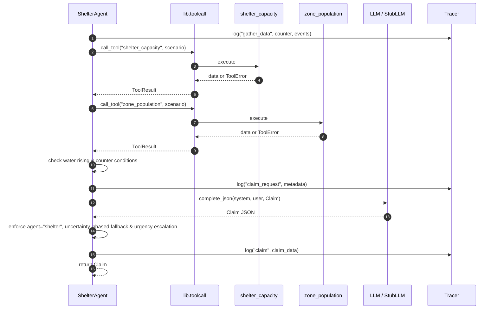

# Shelter Agent (Agent B)

## Role

The Shelter Agent advocates **exclusively** for evacuation transport (e.g. rescue boats),
temporary shelter capacity, and shelter beds for stranded residents during the
multi-agent disaster relief negotiation. It intentionally ignores medical triage and
logistics concerns (which are handled by sibling agents).

It is designed to be **assertive** under scarce resources, while remaining flexible by
offering **phased evacuation** options when challenged by the Mediator. It dynamically
**escalates urgency** when active events or Mediator challenges indicate that floodwaters
are rising faster.

## Tools Used

| Tool | Purpose |
|---|---|
| `shelter_capacity` | Shelter capacity, current occupancy, stranded seeking shelter, deficits |
| `zone_population` | Zone demographics, stranded counts, safe population, road access status |

Both are invoked via `lib.toolcall.call_tool`, ensuring every invocation is logged in the
trace stream and exceptions are safely caught as `ToolError`.

## Functions

| Function | Signature | Description |
|---|---|---|
| `make_claim` | `(state, llm, tracer, counter=None) → Claim` | Gathers tool data, checks for water-rising conditions, prompts LLM, applies phased fallback and escalation adjustments, and returns a validated `Claim`. |
| `estimate` | `(state, question, llm, tracer) → Estimate` | Answers questions regarding evacuation numbers or shelter requirements, backed by live tool data. |

## Prompt Summary

The system prompt (`agents/prompts/shelter.md`) instructs the LLM to:

1. Advocate only for evacuation transport, shelter space, and stranded populations.
2. Be assertive — assert genuine community evacuation needs without premature concession.
3. Use tool data (`shelter_capacity`, `zone_population`) as quantitative justification.
4. On a Counter, defend or propose a **phased evacuation** as the `fallback_option` (e.g., 1 boat over 6 hours for wave 1).
5. On events or counter indicating water rising faster, **escalate urgency** to 9–10 and shorten the time window.
6. On tool failure, set `uncertainty` (0.3–0.8) and describe the demographic/capacity data gap.

## Dynamic Escalation & Phased Fallback

- **Escalation Trigger**: If any string in `state.events` or `counter.question` contains
  flood-surge indicators (e.g., `"water rising"`, `"rising faster"`, `"flood rising"`,
  `"rapid rise"`, `"inundation"`), the agent flags a critical alert to the LLM and guarantees
  that `claim.urgency >= 9`.
- **Phased Evacuation Fallback**: When negotiating past a Mediator challenge (`counter is not None`),
  the fallback option specifically articulates a staged evacuation strategy (e.g. 1 boat deployed
  over 6 hours for primary wave, followed by secondary evacuations).

## Failure Behaviour

When `shelter_capacity` or `zone_population` fails (e.g. via `set_failure()`):

- Tool failure is logged in the trace and passed to the LLM context.
- LLM is instructed to set `uncertainty` between 0.3 and 0.8.
- If the LLM omits uncertainty, the agent enforces a default `uncertainty = 0.5`.
- Returns a fully valid `Claim` model without crashing.

## Tracing

All actions are logged using `Tracer.log()`:

| Sender | Receiver | Type | Context |
|---|---|---|---|
| `shelter` | `tools` | `gather_data` | Includes counter and active event list |
| `toolcall` | `shelter_capacity` | `tool_requested` / `tool_result` | Tool invocation lifecycle |
| `toolcall` | `zone_population` | `tool_requested` / `tool_result` | Tool invocation lifecycle |
| `shelter` | `llm` | `claim_request` | Contains `has_counter`, `tool_failed`, `water_rising` |
| `shelter` | `mediator` | `claim` | Final validated claim payload |
| `shelter` | `llm` | `estimate_request` | Target question for estimation |
| `shelter` | `mediator` | `estimate` | Final validated estimate payload |

## Claim / Counter Flow

