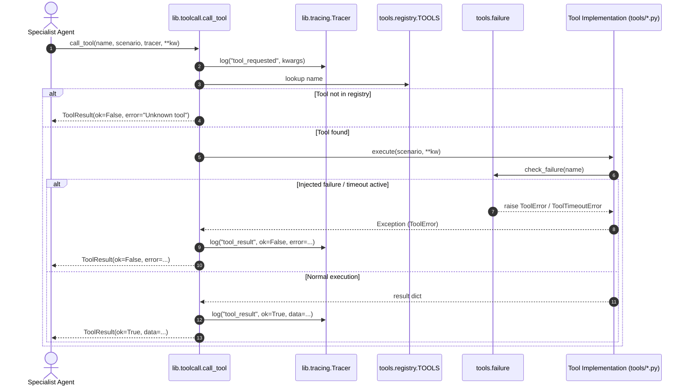

# Scenario Data Tools & Failure Injection (Agent B)

## Overview

The `tools` package provides pure-Python data access tools that specialist agents (Medical, Shelter, Logistics, Scenario, Mediator) query during negotiation rounds. It includes a simulated failure injection mechanism supporting targeted tool failure, wildcard failure, probabilistic random failure, and timeout simulation.

All tools are registered in the `tools.registry.TOOLS` dispatch dictionary and invoked via `lib.toolcall.call_tool`.

---

## Tool Table

| Tool Name | Domain / Target | Key Parameters | Return Keys | Error Behavior |
|---|---|---|---|---|
| `hospital_capacity` | Medical | `scenario`, `hospital=None` | `hospital`, `total_beds`, `available_beds`, `icu_total`, `icu_available`, `surge_capacity`, `status` | Raises `ToolError` if specified hospital is not found |
| `casualty_estimate` | Medical / Triage | `scenario`, `zone=None` | `zone`, `critical_patients`, `estimated_injured`, `stranded_at_risk`, `urgency`, `triage_priority` | Raises `ToolError` if specified zone is not found |
| `shelter_capacity` | Shelter / Evacuation | `scenario`, `zone=None` | `zone`, `shelter_name`, `total_capacity`, `available_capacity`, `stranded_seeking_shelter`, `shelter_deficit`, `status` | Raises `ToolError` if specified zone is not found |
| `zone_population` | Scenario / Demographics | `scenario`, `zone=None` | `zone`, `population`, `stranded`, `critical_patients`, `road_access`, `safe_population`, `evacuation_needed` | Raises `ToolError` if specified zone is not found |
| `road_status` | Logistics / Transit | `scenario`, `zone=None`, `road=None` | `zone`, `condition`, `road_access`, `passable`, `recommended_transport` | Raises `ToolError` if specified road/zone is not found |
| `vehicle_inventory` | Logistics / Assets | `scenario`, `vehicle_type=None` | `vehicle_type`, `count`, `available`, `operational` | Returns `0` available for unknown vehicle types |
| `stock_levels` | Logistics / Supplies | `scenario`, `item=None` | `item`, `quantity`, `status` (`sufficient`, `low`, `depleted`) | Returns `0` quantity for unstocked items |

---

## Tool Signatures

All tool functions accept a `Scenario` Pydantic model (or a dictionary serializable to `Scenario`) and arbitrary keyword arguments for caller flexibility:

```python
def hospital_capacity(scenario: Scenario | dict[str, Any], hospital: str | None = None, **kw: Any) -> dict[str, Any]: ...
def casualty_estimate(scenario: Scenario | dict[str, Any], zone: str | None = None, **kw: Any) -> dict[str, Any]: ...
def shelter_capacity(scenario: Scenario | dict[str, Any], zone: str | None = None, **kw: Any) -> dict[str, Any]: ...
def zone_population(scenario: Scenario | dict[str, Any], zone: str | None = None, **kw: Any) -> dict[str, Any]: ...
def road_status(scenario: Scenario | dict[str, Any], zone: str | None = None, road: str | None = None, **kw: Any) -> dict[str, Any]: ...
def vehicle_inventory(scenario: Scenario | dict[str, Any], vehicle_type: str | None = None, **kw: Any) -> dict[str, Any]: ...
def stock_levels(scenario: Scenario | dict[str, Any], item: str | None = None, **kw: Any) -> dict[str, Any]: ...
```

---

## Failure Injection API & Behavior

Failure injection is controlled via `tools/failure.py`:

```python
def set_failure(name: str | list[str] | set[str] | None = None, mode: str = "error", *, rate: float = 0.5, timeout_sec: float = 0.0) -> None: ...
def is_failing(name: str) -> bool: ...
def check_failure(name: str) -> None: ...
def set_random_mode(enabled: bool = True, rate: float = 0.5, seed: int | None = None) -> None: ...
def set_timeout_mode(enabled: bool = True, timeout_sec: float = 0.0) -> None: ...
def reset_failure() -> None: ...
```

### Modes & Rules

1. **Targeted Failure**: Calling `set_failure("hospital_capacity")` sets only that tool to fail; other tools execute normally.
2. **Wildcard Failure**: Calling `set_failure("*")` causes all registered tools to fail. This is utilized by `app.py` for control room stress tests.
3. **Timeout Simulation**: Calling `set_timeout_mode(True, timeout_sec=...)` or `set_failure(..., mode="timeout")` raises `ToolTimeoutError` (a subclass of `lib.toolcall.ToolError`).
4. **Random / Flaky Mode**: Calling `set_random_mode(True, rate=0.5)` or `set_failure("random")` injects failures with probability `rate` (default `0.5`, off by default).
5. **Clear / Reset**: Calling `set_failure(None)` or `reset_failure()` clears all failure targets and returns tools to healthy operation.
6. **Exception Contract**: Whenever failure is active, the tool raises `lib.toolcall.ToolError`. The boundary caller `lib.toolcall.call_tool` catches `ToolError` and returns `ToolResult(ok=False, error=str(exc))`.

---

## Architecture & Tool Call Flow


